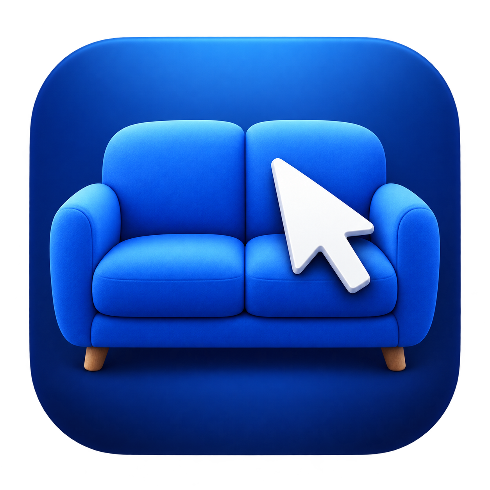

# Sofa Remote

Control your Mac from your phone.

A free, MIT-licensed Mac menu-bar helper and phone-browser remote. No screen streaming, Screen Recording permission, accounts, ads, analytics, subscriptions or cloud relay. Keep using your existing browser, Finder and player.

[Website](https://allamaprabhuani.github.io/sofa-remote/) · [**Download the public beta**](https://github.com/allamaprabhuani/sofa-remote/releases/tag/v0.1.0-beta.3) · [Setup guide](docs/SETUP.md) · [Get help](SUPPORT.md) · [Known issues](KNOWN_ISSUES.md)

**Beta software, macOS 14 or later, Apple silicon and Intel.** Downloads are ad-hoc signed, **not Developer ID notarised**; macOS may block first launch. See the [installation guide](docs/SETUP.md). Direct LAN HTTP is **unencrypted**: use a trusted private network or your own Tailscale connection. Never forward its port to the internet. See [security](SECURITY.md) and [privacy](docs/PRIVACY.md).

## What it does

- Touchpad movement, click, right/double click, drag and two-finger scrolling. Clear local SVG icons and accessible labels.
- Four phone themes: Imperial blue, Light, Ocean and a custom colour picker. Preferences stay in your phone browser.
- Unicode text, keyboard shortcuts, app switcher, Spotlight, media keys, volume and mute.
- Open websites in installed Brave, falling back to your default browser; save and reorder app/website shortcuts.
- Open Downloads in Finder and control IINA's existing playback/subtitle tools with mouse and keyboard input.
- Move the pointer across connected displays. Jump to a chosen display or explicitly move the front window there.
- Request display off/wake while the Mac stays awake. Optional Keep Mac awake and Open at login are off by default.
- Pair phones individually, revoke access, stop sharing, and hide the menu-bar icon. Reopen the app from Applications to find its controls again.
- About & Help on Mac and phone, manual update links and a diagnostic summary you review before copying. No diagnostic upload runs automatically.

The Mac must be awake and reachable. Wake screen does not wake a sleeping Mac, power on separate TV hardware, or unlock macOS. Lock requires a physical unlock and local Resume input afterwards. Sharing an Apple Account does not add automatic unlock. This app does not add ad blocking or guarantee provider/DRM compatibility.

## Start in four steps

1. Download and copy **Sofa Remote.app** to Applications; open it and allow Accessibility when prompted.
2. Choose **Show pairing code** and scan the QR with your iPhone Camera. Pairing expires after five minutes or when its window closes.
3. Move one finger on the touchpad, then tap to click. Test in an empty/disposable window first.
4. In Safari, use **Share → Add to Home Screen** to keep the remote easy to find. The Mac must remain on the same reachable network.

See [the step-by-step setup and recovery guide](docs/SETUP.md) for permissions, reconnecting, displays and power. Closing the Mac window keeps sharing running; **Stop sharing** or **Quit** ends remote access. Hiding the menu-bar icon does not stop sharing.

## Build from source

Requires a current Swift toolchain/Apple command-line tools. There are no package dependencies, npm install or iOS build. A paid developer account is not needed for a local build.

```sh
git clone https://github.com/allamaprabhuani/sofa-remote.git
cd sofa-remote
./build.sh
open 'build/Sofa Remote.app'
```

For a cloud-synchronised checkout, point compiler output at an existing local scratch folder:

```sh
SOFA_BUILD_DIR=/absolute/local/scratch ./build.sh
```

Never replace a running app bundle during an update. Publisher signing and packaging instructions are in [Release guide](docs/RELEASE.md).

## Validation and contribution

```sh
./scripts/test.sh
```

Swift tests use fake input sinks and real loopback transport; browser tests use an isolated test profile and mocked API. These checks do not establish physical-device smoothness or every macOS permission, lock or display state. Initial iPhone checks covered pairing, clicks, cross-display movement/window moves and display off/wake. Occasional pointer stepping or speed changes remain a known beta issue. See [test status and manual matrix](docs/TESTING.md).

Use [bug reports](https://github.com/allamaprabhuani/sofa-remote/issues/new?template=bug_report.yml), [feature requests](https://github.com/allamaprabhuani/sofa-remote/issues/new?template=feature_request.yml), or [Discussions](https://github.com/allamaprabhuani/sofa-remote/discussions). Read [Contributing](CONTRIBUTING.md), [support](SUPPORT.md), [changelog](CHANGELOG.md) and [credits](CONTRIBUTORS.md). Report vulnerabilities [privately](https://github.com/allamaprabhuani/sofa-remote/security/advisories/new).

Copyright © 2026 Allamaprabhu Ani. Selected code is adapted from [Mac TV](https://github.com/Arunprakaash/mac-tv), copyright © 2026 Arunprakaash. The original attribution is retained in [LICENSE](LICENSE) and [NOTICE](NOTICE). Personal shortcuts remain local settings, not public defaults.
